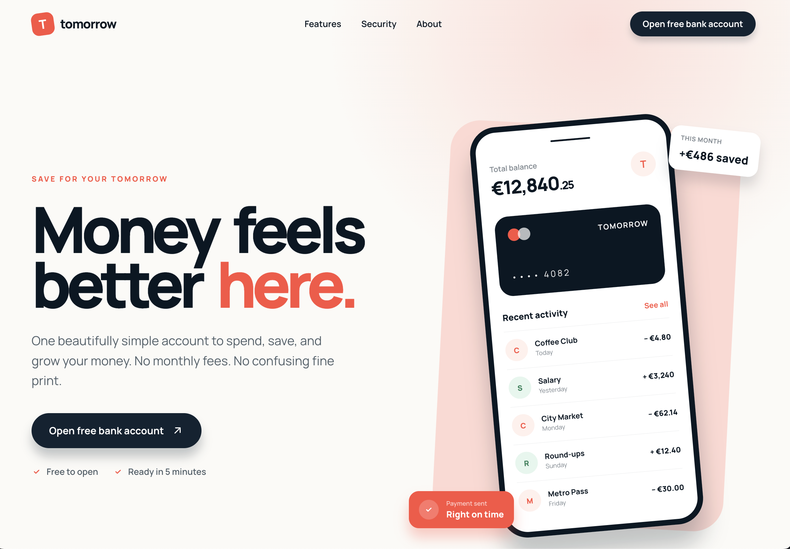
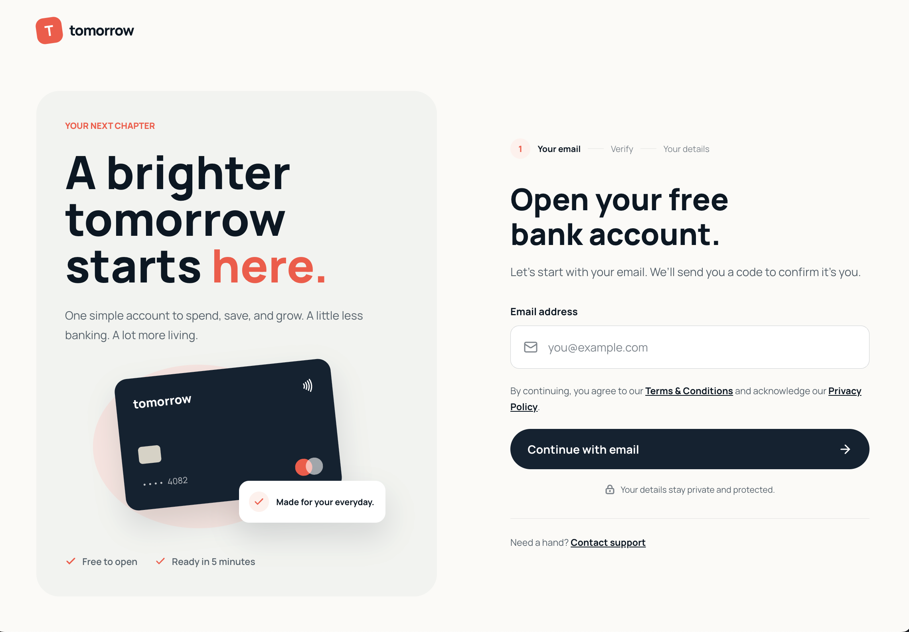

# Bottleneck finder

A 5-day learning project about web performance: a test site for **tomorrow**,
a fictional bank, with four performance problems planted on purpose, plus
[k6](https://k6.io) load tests and an analyser that work out which problem
breaks first, when, and what visitors would experience.

## Setup

Needs **Node.js** 24+ and **k6**. On a Mac with [Homebrew](https://brew.sh)
(for Windows or Linux, see the [k6 install guide](https://grafana.com/docs/k6/latest/set-up/install-k6/)):

```sh
brew install node k6   # first time only (skip node if you have it)
npm install            # first time only
npm run seed           # fills bank.db with 100,000 users: user1@example.com to user100000@example.com
npm start              # http://localhost:3000, stop with Ctrl+C
curl localhost:3000/hello   # in a second terminal: should print "hello"
```

- **`npm run seed`** clears the table first, so it's safe to re-run, and you always get exactly 100,000 users (ids 1 to 100,000). Users added since the last seed are deleted.
- **`npm start`** compiles the React sign-up page (`views/*.jsx` → `build/`) with esbuild, then runs the server with `NODE_ENV=production`. This matters for load tests: React's development build renders about 10 times slower.

## Quiet Tuesday baseline

Response times with nothing else hitting the server, measured with
`./baseline.sh` (1 warm-up request, then the median of 5). Run `npm run seed`
afterwards. Measured on 2026-10-18: Apple M4, macOS 15.3.2, Node 24.21.0.

| Route                            | Status | Median | Slowest | What the time is                                                                            |
| -------------------------------- | ------ | -----: | ------: | ------------------------------------------------------------------------------------------- |
| `GET /hello`                     | 200    |  0.6ms |   0.9ms | Express doing nothing                                                                       |
| `GET /`                          | 200    |  0.7ms |   1.0ms | Static file                                                                                 |
| `GET /styles.css`                | 200    |  0.8ms |   0.8ms | Static file                                                                                 |
| `GET /api/rates`                 | 200    |  243ms |   288ms | Fake CMS wait, random 200-300ms (trap 2)                                                    |
| `GET /signup`                    | 200    |   17ms |    18ms | React render, about 14ms (trap 3)                                                           |
| `POST /api/signup` (new email)   | 201    |  132ms |   148ms | Full table scan, about 4-6ms (trap 1), plus fake email validation, random 50-150ms (trap 4) |
| `POST /api/signup` (taken email) | 409    |  4.3ms |   4.5ms | Full table scan only (trap 1)                                                               |

The rates and new-email times include random waits, so they vary by a few
dozen milliseconds between runs.

## Load tests

With the server running (`npm start`), in a second terminal:

```sh
npm run load:smoke   # 1 virtual user for 10 seconds: checks everything works
npm run load         # main test, about 9.5 minutes
npm run load:signup  # sign-up test, about 11 minutes
```

Both full tests reseed the database first. Run `npm run seed` afterwards to
remove the users they created. For a quick dry run: `RAMP=5s HOLD=5s npm run load`.

Both tests are *open*: k6 starts a set number of visits per second however
slow the site gets, like real public traffic.

|          | Main test (`main.js`)                                                                                         | Sign-up test (`signup.js`)                                                   |
| -------- | ------------------------------------------------------------------------------------------------------------- | ---------------------------------------------------------------------------- |
| Visitors | Land on `/` and load `/api/rates`; 30% go on to `/signup`; 60% of those submit                                | Land straight on `/signup`, like an ad linking to sign-up; 75% submit        |
| Levels   | 5, 12, 24, 35, 45, 57 visits/s: 24 is the expected peak and 57 the campaign peak; 35 and 45 sit around rates' capacity | 10, 25, 40, 55, 70, 100, 160 visits/s (about 70 is the expected peak, 160 the campaign peak) |

Every level ramps up for 30s and holds for 1 minute. Visitors think 1-3s
between steps, and 1 in 10 submissions reuses a seeded email (expects `409`).
The main test's levels come from the peaks in `test-config.json` (visitors at
once / `planning_visit_seconds`), so they move if you change the peaks.

- **Assumptions** are in [load-tests/test-config.json](load-tests/test-config.json): the peaks (110 visitors at once on a busy hour, 260 after an ad), the funnel percentages, visitor patience (3s) and the table size.
- **Route context:** [analyzer/route-context.json](analyzer/route-context.json) says what each route means to a visitor, its fallback, the site's own timeout, and what a visitor does when it fails (`on_failure`).
- **Patience:** visitors leave after 3s on the homepage, the sign-up page and the form. Rates fails quietly after 3s instead (the cards show the fallback), and the visit carries on as *degraded*. k6 uses the site's own timeout or the visitor's patience, whichever is shorter.
- **Counters:** `fallback_shown` counts every request where a visitor would see a fallback, by route and reason (`timeout`, `connection`, `server_error`). `funnel` records each step, including `left` and `degraded` (with where and why), and `signup_lost` for a failed submission.
- **Pass or fail:** a run fails if p95 goes over 500ms (overall or for any route), or if more than 1% of requests fail. Failing is expected: the point is to see which route crosses first.

**Results** go in `load-tests/results/<run>/` (ignored by git):

- `summary.json`: k6's end-of-test summary
- `raw.csv.gz`: every measurement, tagged with its `route`
- `metrics.jsonl`: the server's `GET /metrics`, once a second
- `timeline.json`: one entry per second, with each route's requests/s, p50, p95, errors and timeouts, merged with the server metrics
- `options.json`, `test-config.json`, `route-context.json`: what the run was set up with
- `findings.json`: written by the analyser
- `run.json`: which test it was, the git commit (and whether there were uncommitted changes), and whether the run is `superseded`

Older runs that no longer match the current setup are renamed `<run>-superseded`, with `superseded: true` and a reason in `run.json`. A dashboard should leave them out by default. The analyser still reads them, and labels their findings as superseded.

**Server metrics.** `GET /metrics` reports how busy the server was in the last
second ([metrics.js](metrics.js)):

| Field                                              | Meaning                                                                                                                                                             |
| -------------------------------------------------- | ------------------------------------------------------------------------------------------------------------------------------------------------------------------- |
| `cpuPercent`                                       | CPU the server process used. 100% is one core; it can go a little over because Node also uses helper threads                                                        |
| `eventLoop.utilization`                            | Share of the second the event loop was busy, 0 to 1. Near 1 means Node is saturated and every request waits                                                         |
| `eventLoop.delayP50Ms`, `delayP99Ms`, `delayMaxMs` | How late a 10ms timer fired: roughly how long a new request had to wait for the loop to be free. `null` when the loop was so busy the timer never fired that second |
| `eventLoop.samplerLateMs`                          | How late this 1-second sample itself ran. Also a measure of a blocked loop, and still works when the delay fields are `null`                                        |
| `windowMs`                                         | How long the sample actually covers. Usually 1000, longer when the loop is blocked: divide totals by this, not by 1000                                              |
| `db.<query>`                                       | For each database query: how many ran, their total, average and slowest time in ms, and `op` (`read` or `write`)                                                    |
| `render.<page>`                                    | The same for each server-side React render (`SignupPage`)                                                                                                           |
| `cms`                                              | Fake CMS slots in use (`inFlight` out of `limit`) and requests waiting (`queued`)                                                                                   |
| `memoryMb`                                         | Total memory (`rss`) and JavaScript heap in use                                                                                                                     |
| `pollMs`                                           | Only in `metrics.jsonl`: how long `/metrics` took to answer. A blocked server answers late                                                                          |

## Analyser

```sh
npm run analyze -- load-tests/results/<main run>     # first
npm run analyze -- load-tests/results/<sign-up run>  # then
```

**The sign-up test is a campaign scenario** (`scenario: "campaign"` in `test-config.json`). Every visitor goes straight to `/signup`, which only happens during a sign-up ad, so comparing it with a normal day would overstate the risk: normally about 30% of visitors reach sign-up. Its findings are judged at the campaign peak, and their normal-day impact and headroom come from the latest main run that isn't superseded. So analyse the main run first. If the two runs were made on different code (a different git commit, or uncommitted changes), the findings warn that the normal-day numbers may be out of date, and set `normal_day_confidence` to low.

It writes `findings.json` into the run folder and prints a summary. The code
is in `analyzer/`:

- [analyze.mjs](analyzer/analyze.mjs): the numbers, knees and visit model
- [rules.mjs](analyzer/rules.mjs): the findings
- [describe.mjs](analyzer/describe.mjs): the wording

The rules use only what was measured, never the names of the planted problems.

1. **Per-stage numbers** for each 1-minute hold, per route and for the server. Times and throughput count successful requests only: a refused connection fails instantly, so it isn't a wait or a completed request.
2. **The knee:** the first stage where a route's p95 is at least 1.5x the previous stage's _and_ at least 100ms slower, or where errors go over 1%.
3. **What was saturated at the knee:**
   - a pool with every slot busy and requests queueing, or
   - the event loop 90%+ busy (or requests waiting 100ms+ to start).

   Busy time is split between timed renders and queries. A timed operation belongs to the route whose successful requests match its call count.

4. **The visit model,** from the healthy stages before any knee: how long a visit lasts, and how many requests of each route it makes. Each stage also reports the *measured* visitors at once (active virtual users), next to the planned number: when the site slows down, visits stretch and the measured number grows, a sign of people stuck waiting. Peaks are matched to stages by arrivals, using the planned number.

Each finding has:

| Field                                          | How it's worked out                                                                                                                                                                                                                                     |
| ---------------------------------------------- | ------------------------------------------------------------------------------------------------------------------------------------------------------------------------------------------------------------------------------------------------------- |
| `knee_at`                                      | The stage, its load, and the p95 before and after                                                                                                                                                                                                       |
| `evidence`, `likely_cause`, `suggested_fix`    | Plain sentences with the measured numbers                                                                                                                                                                                                               |
| `confidence`                                   | high: 2+ signals that weren't there at the previous stage; medium: 1; low: nothing measured was saturated                                                                                                                                               |
| `user_impact_now`, `_at_campaign`, `_at_limit` | At the stage closest to the expected peak, the campaign peak and the highest load, first the outcomes: visitors who left (and why), lost sign-ups and degraded visits. Then the waits for those who got an answer ("half over X, 1 in 20 over Y") and visits with at least one wait in the slowest 5%, 1 - 0.95^(requests per visit) |
| `capacity`                                     | The most successful requests/s reached at any stage up to the knee (past it, useful throughput can collapse), and visitors at once = visits/s x visit length (Little's law)                                                                                                                                                        |
| `headroom`                                     | (break point - peak) / peak, at both peaks; below 0 means already over                                                                                                                                                                                  |
| `fallback_point`                               | Predicted: the wait reaches the timeout after timeout x capacity / (arrivals - capacity) seconds. Measured: the first timeout, when timeouts become sustained (1%+ for 3s), and refused connections. A closed test can't confirm the prediction         |
| `if_ignored`                                   | "capacity cliff" (fine, then it tips over), "grows with data" (a slow single-row read suggests a full scan) or "stable"                                                                                                                                 |
| `severity`                                     | critical: over the limit or failing at expected peak; high: under 50% headroom at expected peak, or over at campaign peak; medium: under 50% at campaign peak; low: the rest. For a campaign scenario: high if over the limit or failing at campaign peak, medium if under 50% to spare there, low otherwise, but critical if the main test shows normal days failing too. A failure on a critical route (`POST /api/signup`) makes it at least high |
| `can_wait`                                     | One sentence from the severity and headroom                                                                                                                                                                                                             |

`findings.json` also has the funnel: how many visitors reached each step, the
voluntary drop-off (left the sign-up page), and the lost sign-ups (the
submission failed or timed out) at both peaks.

## Routes

| Route                                                                   | What it does                                                                                                                       |
| ----------------------------------------------------------------------- | ---------------------------------------------------------------------------------------------------------------------------------- |
| `GET /hello`                                                            | `hello`, to check the server is up                                                                                                 |
| `GET /metrics`                                                          | How busy the server was in the last second (JSON), not cached                                                                      |
| `GET /`                                                                 | Homepage (HTML), cacheable for 1 hour. Its script `home.js` loads `/api/rates` and gives up after 3s                               |
| `GET /styles.css`, `/home.js`, `/signup.js`, `/icons/*`, `/favicon.svg` | Static files, cacheable for 1 hour                                                                                                 |
| `GET /api/rates`                                                        | Savings rates (JSON), 200-300ms when quiet, slower under load                                                                      |
| `GET /signup`                                                           | Sign-up page (HTML), rendered by React on every request, not cached. Its script `signup.js` submits the form and gives up after 3s |
| `POST /api/signup`                                                      | Creates a user from `{"email": "..."}`: `201` created, `400` not an email, `409` already taken                                     |

To try a sign-up from the terminal:

```sh
curl -i -H 'Content-Type: application/json' -d '{"email":"me@example.com"}' localhost:3000/api/signup
```

## Planted problems

These are marked `// TRAP:` in the code, so you can check whether the analyser
finds them.

| #   | Problem                                                                                                                                                                                                                                                 | Where                               |
| --- | ------------------------------------------------------------------------------------------------------------------------------------------------------------------------------------------------------------------------------------------------------- | ----------------------------------- |
| 1   | **No index on email:** sign-up checks for an existing email with a full table scan                                                                                                                                                                      | `db.js`, `server.js`                |
| 2   | **Uncached CMS call:** every rates request calls a fake CMS that allows only 10 requests at once and queues the rest, like a real rate-limited service                                                                                                  | `server.js`, `cms.js`               |
| 3   | **Uncached server-side rendering:** the sign-up page is rendered with React on every request, blocking the event loop. `RENDER_WEIGHT` sets the cost: invisible helper components, like the analytics and feature-flag components real apps are full of | `server.js`, `views/SignupPage.jsx` |
| 4   | **Bonus, correctness under load:** an awaited fake "email validation" between the existence check and the insert lets duplicate emails through under concurrency. _Not load tested yet: every test email is unique_                                     | `server.js`, `emailValidation.js`   |

Sign-up only asks for an email; the account is finished in the app, so
passwords never touch the website. [DATAFLOW.md](DATAFLOW.md) shows how the
files talk to each other.

## The fictional bank

The homepage (`GET /`):



The sign-up page (`GET /signup`):


